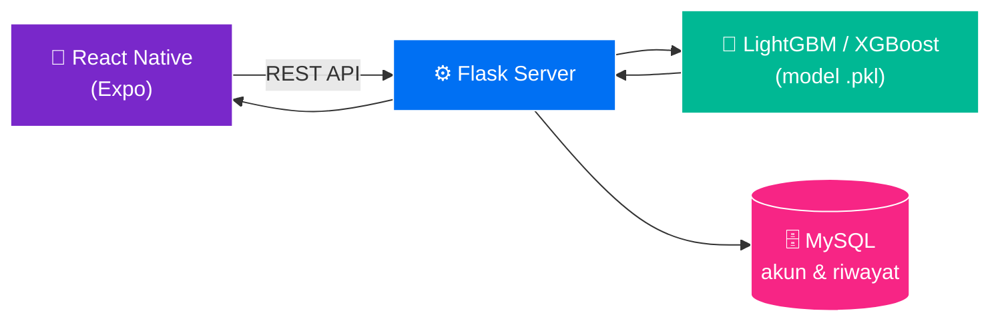
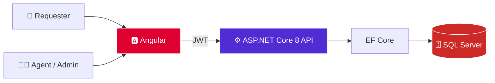

<div align="center">


<a href="https://github.com/Benny29281">

</a>

<br>


<br>


<br><br>

<a href="https://github.com/Benny29281">

</a>
<a href="https://github.com/Benny29281?tab=followers">

</a>
<a href="https://github.com/Benny29281?tab=repositories">

</a>

</div>

<br>

<div align="center">

## `> INITIALIZING BENNY_DWIYANTO...`


</div>

---

# 👨‍💻 `ABOUT_ME`

<div align="center">
<table>
<tr>
<td width="55%" valign="top">

### `WHO AM I?`

Hai! Saya **Benny Dwiyanto**, lulusan **Teknik Informatika, Universitas Tarumanagara**, dengan minat besar pada **backend, aplikasi web & mobile, database, dan machine learning**.

Saya senang mengubah masalah nyata menjadi software yang praktis, mulai dari sistem manajemen internal, aplikasi mobile, sampai backend flash-sale dengan Go.

```text
Frontend → Backend → API → Database → ML → Deployment
```

</td>
<td width="45%" valign="top">

### `CURRENT STATUS`

```text
┌──────────────────────────────┐
│  👨‍💻 BENNY DWIYANTO           │
│                              │
│  Role      : Software Dev    │
│  Focus     : Backend • Web   │
│  Learning  : Go • .NET • ML  │
│  Location  : Indonesia 🇮🇩    │
│  Status    : ● ONLINE        │
└──────────────────────────────┘
```


</td>
</tr>
</table>
</div>

---

# 🧊 `3D_CONTRIBUTION_WORLD`

<div align="center">


</div>

---

# ⚡ `WHAT_I_BUILD`

<div align="center">

| ⚙️ BACKEND | 🌐 WEB | 📱 MOBILE | 🤖 MACHINE LEARNING |
| :--------: | :----: | :-------: | :------------------: |
| Go (Golang) | Next.js + TypeScript | React Native (Expo) | Klasifikasi tabular |
| ASP.NET Core | Angular | Android (Java) | LightGBM |
| Laravel (PHP) | Laravel Blade | Firebase | XGBoost |
| Flask | Tailwind • Bootstrap | REST API client | Evaluasi model |
| JWT • Redis • Kafka | Payload CMS | Autentikasi | Data processing |

</div>

---

# 🛠️ `TECH_STACK`

<div align="center">

### 🔤 Languages


### 🧩 Frameworks


### 🗄️ Data & Infrastructure


### 🤖 Machine Learning


### 🧰 Tools


</div>

---

# 🚀 `PROJECTS`

<div align="center">

### 📌 Daftar Proyek

| # | Proyek | Jenis | Stack utama | Repo |
|:-:|:-------|:------|:------------|:----:|
| 01 | 🫁 **AsthmaScreen** | Mobile + ML | React Native • Flask • LightGBM • XGBoost • MySQL | [🔗](https://github.com/Benny29281/Asthmascreen) |
| 02 | 🛒 **BenzMart** | Backend flash sale | Go • MySQL • Kafka • Redis • Docker | [🔗](https://github.com/Benny29281/benzmart_go-golang-) |
| 03 | 🎫 **HelpDeskKu** | Ticketing IT | ASP.NET Core 8 • Angular • SQL Server | [🔗](https://github.com/Benny29281/project-tiket) |
| 04 | 🌏 **Indonesia Pacific Trade** | Company profile + commerce | Next.js • TypeScript • Payload CMS • PostgreSQL | [🔗](https://github.com/Benny29281/Project-Website-IPT-) |
| 05 | 🎮 **Steizen Store** | Top-up game | Laravel 13 • Blade • SQLite/MySQL | [🔗](https://github.com/Benny29281/Steizen-top-up) |
| 06 | 🏷️ **Sorex.id** | Manajemen request branding | Laravel • Bootstrap • jQuery • Tailwind | [🔗](https://github.com/Benny29281/SorexBrandingLaravel) |
| 07 | ☕ **Atlantis Nako** | Android app | Java • Firebase | [🔗](https://github.com/Benny29281/Atlantis-Nako) |
| 08 | 🖼️ **IPT Katalog** | Galeri Google Drive | HTML • JavaScript • Google Drive API | [🔗](https://github.com/Benny29281/project-katalog) |
| 09 | 🎨 **Portofolio** | Website portofolio | React • Vite • CSS 3D | [🔗](https://github.com/Benny29281/Portofolio_Benny_Dwiyanto) |

</div>

<br>

<table>
<tr>
<td width="33%" valign="top">

### 🫁 AsthmaScreen
Skrining risiko asma, mobile + ML.

<a href="https://github.com/Benny29281/Asthmascreen"></a>
<a href="https://github.com/Benny29281/Asthmascreen"></a>

</td>
<td width="33%" valign="top">

### 🛒 BenzMart
Backend flash sale dengan Go.

<a href="https://github.com/Benny29281/benzmart_go-golang-"></a>
<a href="https://github.com/Benny29281/benzmart_go-golang-"></a>

</td>
<td width="33%" valign="top">

### 🎫 HelpDeskKu
Ticketing IT: .NET + Angular.

<a href="https://github.com/Benny29281/project-tiket"></a>
<a href="https://github.com/Benny29281/project-tiket"></a>

</td>
</tr>
<tr>
<td width="33%" valign="top">

### 🌏 IPT Website
Company profile 4 bahasa.

<a href="https://github.com/Benny29281/Project-Website-IPT-"></a>
<a href="https://github.com/Benny29281/Project-Website-IPT-"></a>

</td>
<td width="33%" valign="top">

### 🎮 Steizen Store
Top-up game dengan Laravel 13.

<a href="https://github.com/Benny29281/Steizen-top-up"></a>
<a href="https://github.com/Benny29281/Steizen-top-up"></a>

</td>
<td width="33%" valign="top">

### 🏷️ Sorex.id
Manajemen request branding.

<a href="https://github.com/Benny29281/SorexBrandingLaravel"></a>
<a href="https://github.com/Benny29281/SorexBrandingLaravel"></a>

</td>
</tr>
</table>

---

## 🫁 `01 · ASTHMASCREEN`

<div align="center">


**Aplikasi klasifikasi dan skrining awal risiko asma** (skripsi, Teknik Informatika UNTAR). Aplikasi mobile mengirim **27 atribut klinis** ke backend Flask, lalu model machine learning mengembalikan hasil prediksi risiko.

> ⚠️ Fokus proyek adalah alur skrining risiko, **bukan diagnosis medis**.

</div>

**Fitur:** form skrining 27 atribut klinis • hasil prediksi & analisis • autentikasi & profil • riwayat skrining • ekspor PDF • evaluasi model



```text
DATASET → EKSPLORASI → PREPROCESSING → OVERSAMPLING → TRAIN/TEST
→ LIGHTGBM & XGBOOST → EVALUASI → MODEL TERBAIK → FLASK API → MOBILE APP
```

🔗 [Lihat repository](https://github.com/Benny29281/Asthmascreen) · Dilengkapi `Dockerfile`, `Procfile`, manual book, dan panduan instalasi.

---

## 🛒 `02 · BENZMART` &nbsp;

<div align="center">


**Backend platform e-commerce flash sale** berbasis PRD, dimulai sebagai *modular monolith*.

</div>

**Sudah tersedia:**
- 🔐 Registrasi (UUIDv7, bcrypt cost 12), login **JWT HS256** (15 menit) + refresh token acak (7 hari)
- ♻️ Rotasi refresh token dengan transaksi & row lock, disimpan sebagai hash SHA-256
- 🚦 Rate limit berbasis Redis untuk login, registrasi, dan refresh
- 👮 RBAC, endpoint admin, profil pengguna
- 🧪 Migrasi MySQL berversi (`golang-migrate`), health/readiness check, structured logging, graceful shutdown
- 🐳 Docker Compose + CI GitHub Actions (MySQL 8.4)

**Berikutnya:** katalog, campaign flash sale, checkout, outbox + event Kafka, pembayaran.

🔗 [Lihat repository](https://github.com/Benny29281/benzmart_go-golang-)

---

## 🎫 `03 · HELPDESKKU` &nbsp;

<div align="center">


**Aplikasi manajemen tiket dukungan IT** dengan tiga role (Requester, Agent, Admin).

</div>

**Fitur:** nomor tiket otomatis `HD-YYYYMM-0001` • filter status/prioritas/kategori/agen • transisi status & penugasan agen • komentar publik + catatan internal • timeline otomatis • dashboard per role • target SLA & penanda overdue • arsip tiket • JWT + refresh token berotasi + lockout • tes otomatis workflow & otorisasi • CI.



🔗 [Lihat repository](https://github.com/Benny29281/project-tiket)

---

## 🌏 `04 · INDONESIA PACIFIC TRADE`

<div align="center">


**Website company profile PT Indonesia Pacific Trade** dengan fondasi e-commerce.

</div>

- 🌐 Konten **empat bahasa**: Indonesia, Inggris, Mandarin, Korea (`next-intl`)
- 🧱 Next.js App Router + Payload CMS + PostgreSQL
- 🏢 Halaman bidang bisnis (ICT, Photography, Consumer Electronics, Non-Heat Burns), footer company profile, halaman kebijakan
- 🛍️ Katalog produk, keranjang, dan integrasi Midtrans *(perlu konfigurasi layanan & database sebelum dipakai)*

🔗 [Lihat repository](https://github.com/Benny29281/Project-Website-IPT-)

---

## 🎮 `05 · STEIZEN STORE` &nbsp;

<div align="center">


**Website top-up multi game** dengan tema biru-ungu.

</div>

- 🎯 Katalog **8 game**, pencarian, filter kategori, formulir per game, pilihan nominal
- 🧾 Pesanan permanen & invoice, dashboard admin
- 🔌 Konektor katalog **Digiflazz** dan pembayaran **Tripay sandbox** tersedia di kode
- 🛡️ Dilengkapi `SECURITY.md`, tes, dan konfigurasi deploy Apache
- ℹ️ Pembayaran riil & pengiriman item belum diaktifkan

🔗 [Lihat repository](https://github.com/Benny29281/Steizen-top-up)

---

## 🏷️ `06 · SOREX.ID — BRANDING REQUEST SYSTEM`

<div align="center">


**Sistem pengelolaan permintaan branding** dari berbagai wilayah, dengan alur akses dan pelaporan yang terstruktur. Dikembangkan saat magang di SOREX.

</div>

```text
branding_status (HTML/JS)  →  Sorex_branding (PHP Native)  →  SorexBrandingLaravel (Laravel)
     prototipe awal              dashboard + export Excel          versi terbaru, lebih terstruktur
```

🔗 [Repo Laravel](https://github.com/Benny29281/SorexBrandingLaravel) · [Repo PHP Native](https://github.com/Benny29281/Sorex_branding) · [Prototipe awal](https://github.com/Benny29281/branding_status)

---

## 🧩 `PROYEK LAINNYA`

<table>
<tr>
<td width="33%" valign="top">

### ☕ Atlantis Nako


Aplikasi Android yang menggabungkan **pembelian kopi dan tiket wahana** dalam satu alur transaksi.

[🔗 Repo](https://github.com/Benny29281/Atlantis-Nako)

</td>
<td width="33%" valign="top">

### 🖼️ IPT Katalog


Galeri foto berbasis **Google Drive** dengan pencarian, tampilan grid/list, dan lightbox. Di-host gratis di GitHub Pages.

[🔗 Repo](https://github.com/Benny29281/project-katalog)

</td>
<td width="33%" valign="top">

### 🎨 Portofolio


Website portofolio dengan **ilustrasi CSS 3D**, filter & pencarian proyek, dan halaman detail. Siap deploy ke GitHub Pages.

[🔗 Repo](https://github.com/Benny29281/Portofolio_Benny_Dwiyanto)

</td>
</tr>
</table>

---

# 📊 `GITHUB_STATS`

<div align="center">


<br><br>

</div>

---

# 🏢 `EXPERIENCE`

## `SOREX — IT SUPPORT & SOFTWARE DEVELOPMENT`
**PT Prakarsa Jaya Sentosa / SOREX** · `JAN 2025 — JUN 2025`

- 🖥️ Mengembangkan dashboard web internal
- 🧩 Membangun fitur manajemen request branding tool
- ⚙️ Bekerja dengan **PHP Native, Bootstrap, MySQL, dan Laragon**
- 🔀 Menggunakan Git & GitHub untuk source code management
- 🌐 Berkontribusi pada pengembangan & maintenance website
- 📝 Membantu tugas teknis IT dan pelaporan

---

# 🧠 `DEVELOPER_MINDSET`

<div align="center">

```text
IDEA → UNDERSTAND PROBLEM → ANALYZE → BUILD → TEST & DEBUG → DEPLOY → IMPROVE → 🔄 REPEAT
```


</div>

---

# 🤝 `SOFT_SKILLS`

<div align="center">


<br>


</div>

---

# 🖥️ `TERMINAL`

<div align="center">

```text
┌────────────────────────────────────────────────────────────┐
│ benny@developer:~$                                         │
├────────────────────────────────────────────────────────────┤
│ $ whoami           → Benny Dwiyanto                        │
│ $ role             → Software Developer                    │
│ $ education        → Teknik Informatika, UNTAR             │
│ $ languages        → Go / PHP / C# / TS / Python / Java    │
│ $ databases        → MySQL / PostgreSQL / SQL Server       │
│ $ status           → ● ONLINE                              │
│ $ echo "Let's build something."                            │
│ Let's build something.                                     │
│ $ █                                                        │
└────────────────────────────────────────────────────────────┘
```

</div>

---

# 🐍 `CONTRIBUTION_SNAKE`

<div align="center">


</div>

---

# 🔭 `CURRENTLY_EXPLORING`

<div align="center">

```text
🐹 Go & Microservices → 📨 Event-driven (Kafka) → 🐳 Docker & CI/CD
→ ⚙️ Backend Architecture → 🔐 Auth & Security → 🤖 Machine Learning
→ 🌐 Modern Web (Next.js, Angular) → 🗄️ Database Optimization
```

</div>

---

# 🎯 `2026_GOALS`

```text
[████████████████████░░]  BUILD STRONGER BACKEND SYSTEMS
[██████████████████░░░░]  MASTER MODERN WEB DEVELOPMENT
[███████████████░░░░░░░]  IMPROVE CLOUD & DEPLOYMENT SKILLS
[████████████████░░░░░░]  BUILD MORE REAL-WORLD PROJECTS
[██████████████████░░░░]  KEEP LEARNING & SHIPPING
```

---

# 📫 `LET'S_CONNECT`

<div align="center">

<a href="https://github.com/Benny29281">

</a>
<a href="https://www.linkedin.com/in/Bennydwiyanto/">

</a>

<br><br>


</div>
