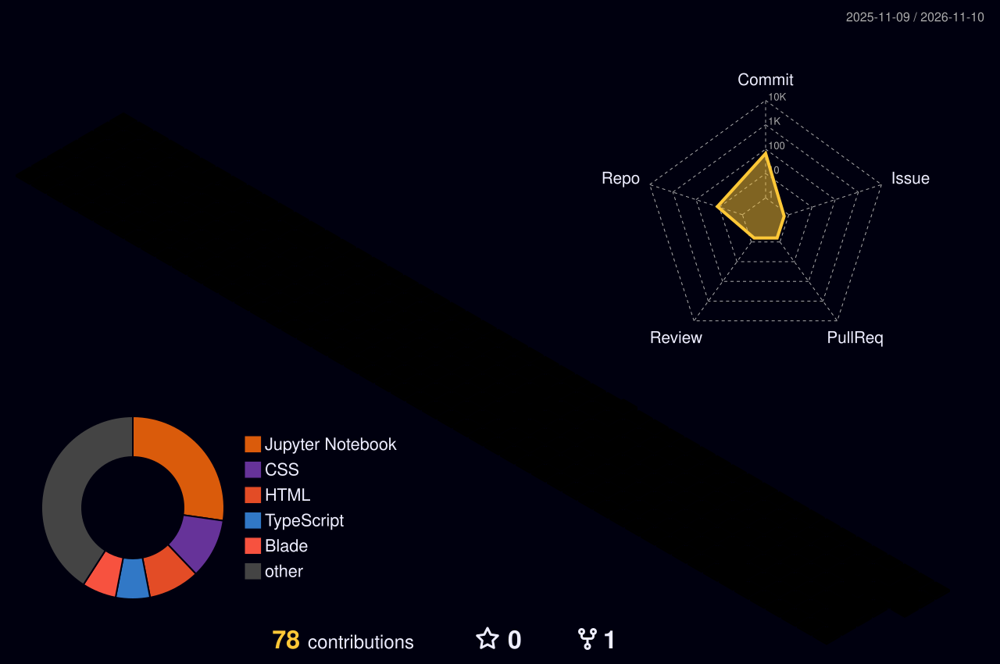
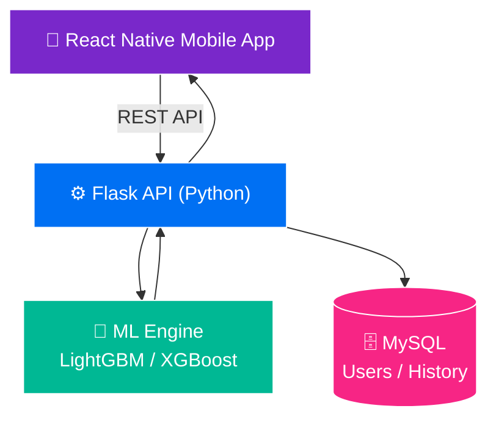

<div align="center">


<a href="https://github.com/Benny29281">

</a>

<br>


<br><br>

<a href="https://github.com/Benny29281">

</a>
<a href="https://github.com/Benny29281?tab=followers">

</a>
<a href="https://github.com/Benny29281?tab=repositories">

</a>

</div>

<br>

<div align="center">

## `> INITIALIZING BENNY_DWIYANTO...`


</div>

---

# 👨‍💻 `ABOUT_ME`

<div align="center">
<table>
<tr>
<td width="55%" valign="top">

### `WHO AM I?`

Hai! Saya **Benny Dwiyanto**, lulusan Teknologi Informasi dengan minat besar pada **pengembangan perangkat lunak, sistem backend, aplikasi web & mobile, database, dan machine learning**.

Saya senang mengubah ide dan permasalahan dunia nyata menjadi solusi software yang praktis dan berguna.

```text
Frontend → Backend → API → Database → Machine Learning → Deployment
```

</td>
<td width="45%" valign="top">

### `CURRENT STATUS`

```text
┌──────────────────────────────┐
│  👨‍💻 BENNY DWIYANTO           │
│                              │
│  Role      : Software Dev    │
│  Focus     : Backend • ML    │
│  Location  : Indonesia 🇮🇩    │
│  Status    : ● ONLINE        │
└──────────────────────────────┘
```


</td>
</tr>
</table>
</div>

---

# 🧊 `3D_CONTRIBUTION_WORLD`

<div align="center">

<!-- File ini dibuat otomatis oleh GitHub Action (lihat file .github/workflows/profile-3d.yml) -->


</div>

---

# ⚡ `WHAT_I_BUILD`

<div align="center">

| ⚙️ BACKEND | 🎨 FRONTEND | 📱 MOBILE | 🤖 MACHINE LEARNING |
| :--------: | :---------: | :-------: | :------------------: |
| REST API | Web UI | React Native | Classification |
| Laravel | HTML / CSS | API Integration | LightGBM |
| PHP | JavaScript | Authentication | XGBoost |
| Flask | Bootstrap | Database | Data Processing |
| MySQL | Responsive UI | Mobile UX | Model Evaluation |

</div>

---

# 🛠️ `TECH_STACK`

<div align="center">

### 🔤 Languages


### 🧩 Frameworks & Development


### 🤖 Data & Machine Learning


### 🧰 Tools


</div>

---

# 📊 `GITHUB_STATS`

<div align="center">


<br>


<br><br>


<br><br>


</div>

---

# 🧠 `DEVELOPER_MINDSET`

<div align="center">

```text
IDEA → UNDERSTAND PROBLEM → ANALYZE → BUILD → TEST & DEBUG → DEPLOY → IMPROVE → 🔄 REPEAT
```


</div>

---

# 🚀 `FEATURED_PROJECT`

<div align="center">

## 🫁 `ASTHMASCREEN`


### `Machine Learning Based Asthma Screening Application`

AsthmaScreen adalah aplikasi mobile untuk **skrining dini asma** menggunakan model klasifikasi machine learning, menggabungkan `Mobile Development` + `Backend API` + `Database` + `Machine Learning`.

</div>

### 🔥 Fitur Utama

| 📱 Mobile App | 🔐 Authentication | 👤 User Profile |
| :--- | :--- | :--- |
| 🫁 Asthma Screening | 🧠 ML Classification | ⚙️ Flask REST API |
| 🗄️ MySQL Database | 📋 Screening History | 📄 PDF Report |
| 📊 Model Evaluation | | |

### 🧬 System Architecture



### 🤖 Machine Learning Pipeline

```mermaid
flowchart LR
    A[Dataset] --> B[Exploration] --> C[Preprocessing] --> D[Feature Set] --> E[ADASYN]
    E --> F[Train / Test] --> G["LightGBM & XGBoost"] --> H[Model Evaluation] --> I[Best Model]
    I --> J[Flask API] --> K[Mobile App]
    style G fill:#00B894,stroke:#fff,color:#fff
    style K fill:#7928CA,stroke:#fff,color:#fff
```



---

# 🏢 `EXPERIENCE`

## `SOREX — IT SUPPORT & SOFTWARE DEVELOPMENT`
**PT Prakarsa Jaya Sentosa / SOREX** · `JAN 2025 — JUN 2025`

- 🖥️ Mengembangkan dashboard web internal
- 🧩 Membangun fitur manajemen request branding tool
- ⚙️ Bekerja dengan **PHP Native, Bootstrap, MySQL, dan Laragon**
- 🔀 Menggunakan Git & GitHub untuk source code management
- 🌐 Berkontribusi pada pengembangan & maintenance website
- 📝 Membantu tugas teknis IT dan pelaporan

---

# 🤝 `SOFT_SKILLS`

<div align="center">


<br>


</div>

---

# 🖥️ `TERMINAL`

<div align="center">

```text
┌────────────────────────────────────────────────────────────┐
│ benny@developer:~$                                         │
├────────────────────────────────────────────────────────────┤
│ $ whoami           → Benny Dwiyanto                        │
│ $ role             → Software Developer                    │
│ $ specialization   → Backend / Frontend / Mobile / ML      │
│ $ languages        → PHP / Python / Java / JS / SQL        │
│ $ database         → MySQL                                 │
│ $ status           → ● ONLINE                              │
│ $ echo "Let's build something."                            │
│ Let's build something.                                     │
│ $ █                                                        │
└────────────────────────────────────────────────────────────┘
```

</div>

---

# 🐍 `CONTRIBUTION_SNAKE`

<div align="center">


</div>

---

# 🔭 `CURRENTLY_EXPLORING`

<div align="center">

```text
☁️ Cloud & Deployment → ⚙️ Backend Architecture → 🔗 REST API & Integration
→ 🤖 Machine Learning → 📱 Mobile Development → 🌐 Modern Web Development
→ 🗄️ Database Optimization → 🚀 Software Engineering
```

</div>

---

# 🎯 `2026_GOALS`

```text
[████████████████████░░]  BUILD STRONGER BACKEND SYSTEMS
[██████████████████░░░░]  MASTER MODERN WEB DEVELOPMENT
[███████████████░░░░░░░]  IMPROVE CLOUD & DEPLOYMENT SKILLS
[████████████████░░░░░░]  BUILD MORE REAL-WORLD PROJECTS
[██████████████████░░░░]  KEEP LEARNING & SHIPPING
```

---

# 📫 `LET'S_CONNECT`

<div align="center">

<a href="https://github.com/Benny29281">

</a>
<a href="https://www.linkedin.com/in/Bennydwiyanto/">

</a>

<br><br>


</div>
